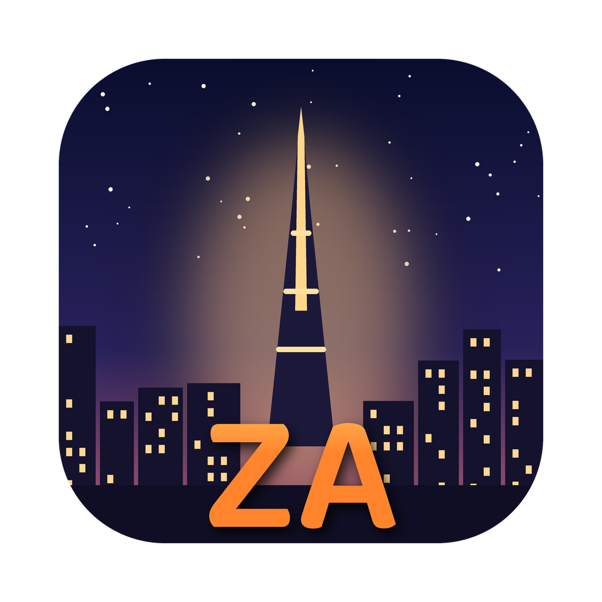
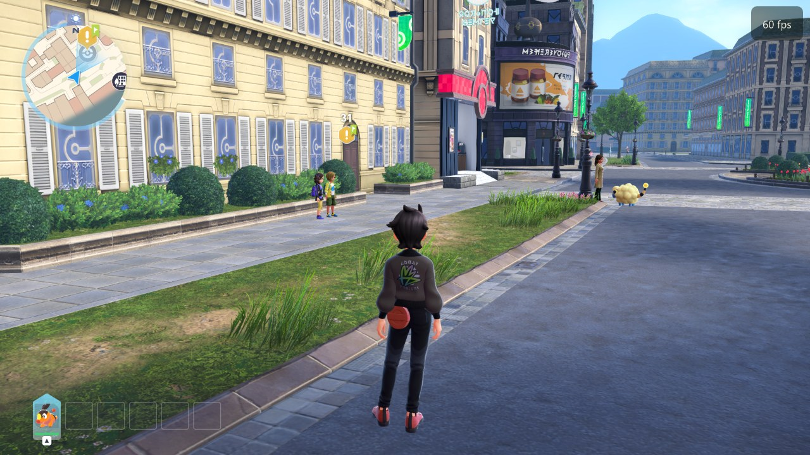
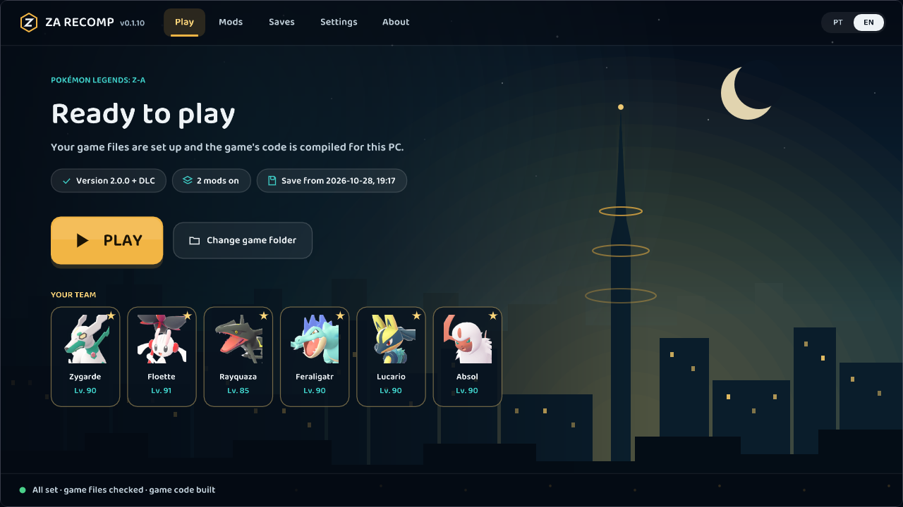
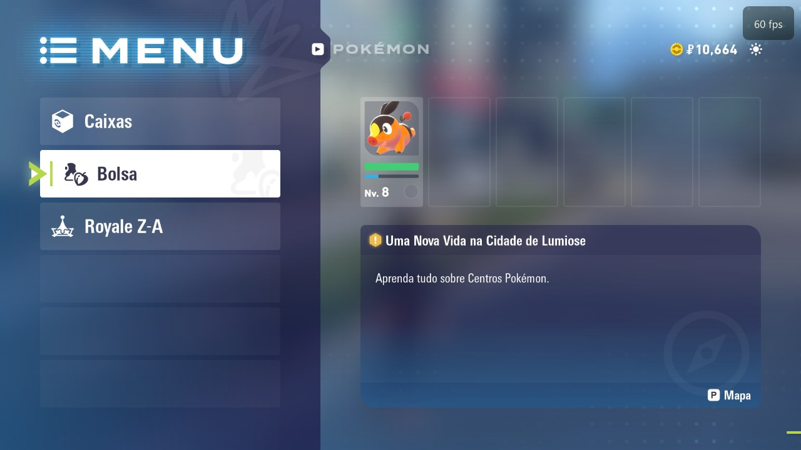
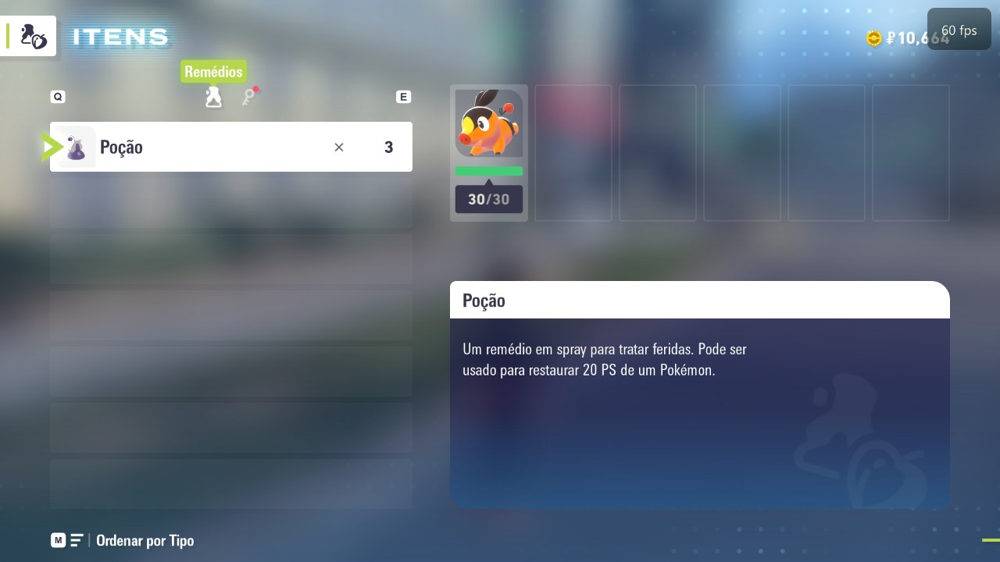

<div align="center">



# PokeZ-ARecomp (ZA Recomp)

**A high-performance native PC port of *Pokémon Legends: Z-A*, built with static recompilation.**

[](https://github.com/Hexveil404/PokeZ-ARecomp)
[](https://github.com/guisaifora-lab/PokeZ-ARecomp/releases)
[](https://github.com/guisaifora-lab/PokeZ-ARecomp/actions)
[](LICENSE)

[Official Upstream Project](https://github.com/Hexveil404/PokeZ-ARecomp) ·
[Releases & Downloads](https://github.com/guisaifora-lab/PokeZ-ARecomp/releases) ·
[Report an Issue](https://github.com/guisaifora-lab/PokeZ-ARecomp/issues) ·
[Portuguese (Brasil)](README.pt-BR.md)

</div>

---

## 📖 About The Project

**ZA Recomp** translates the Nintendo Switch ARM64 binary of *Pokémon Legends: Z-A* into native x86-64 machine code ahead-of-time (AOT) for your PC. Rather than running through an emulator during gameplay, the game executes as a genuine, native desktop application. 

- **Static Recompilation:** Original AArch64 executable code is decompressed, analyzed, lifted into optimized C code, and compiled natively using Clang/Zig for your exact CPU.
- **Vulkan Graphics Engine:** Re-implements Nintendo's NVN graphics API directly on top of Vulkan 1.2+, translating Maxwell GPU shaders into native SPIR-V shaders with ultra-low draw-call overhead.
- **High-Level Emulation (HLE):** OS services (audio, filesystem, input, save management) are handled directly by native lightweight host routines.

> [!NOTE]
> This repository is a fork of the official project **[Hexveil404/PokeZ-ARecomp](https://github.com/Hexveil404/PokeZ-ARecomp)**, which is itself built upon **[LAS Recomp](https://github.com/peiikai/LASRecomp)** by Peiikai.

---

## 🌟 What This Fork Adds

This fork ([guisaifora-lab/PokeZ-ARecomp](https://github.com/guisaifora-lab/PokeZ-ARecomp)) is specifically enhanced to maximize hardware compatibility, fix runtime crashes, and provide automated CI release builds:

### 1. Broad CPU Compatibility (No AVX2 Requirement)
* **Legacy & Enterprise CPU Support:** Upstream ZA Recomp requires CPUs with modern AVX2 and FMA3 instruction sets. This fork dynamically detects your host processor features and builds native code tailored to older CPU architectures—including **Intel Sandy Bridge / Ivy Bridge (Core i7-3770, Xeon E5 v1/v2), 1st-generation Core i5/i7, and older AMD CPUs**.
* **Precise Software FMA Emulation:** For CPUs without hardware FMA instructions, fused multiply-adds are handled through an exact, verified software fallback (`runtime/simd.h`), ensuring zero mathematical drift or physics glitches.

### 2. Runtime Access Violation Fixes
* **Speculative CSEL Null Dereference Guard:** Resolves the critical startup crash (`exception c0000005 accessing 0xd0`). In Switch binaries, Clang inlines singleton getters with speculative conditional selects (`csel`) that dereference unmapped low-memory offsets (such as `0xd0` in `LanguageSelectControlView`). This fork protects all speculative load sites with safe memory boundaries.

### 3. Automated Windows CI & Clean Packaging
* Fully automated GitHub Actions workflow (`.github/workflows/windows-build.yml`) that builds isolated LGPL FFmpeg, compiles tools, packages the standalone release archive (`ZA-Recomp-windows.zip`), and automatically publishes GitHub releases.

---

## 🖥️ Screenshots

| | |
|---|---|
|  |  |
| *Lumiose City running at 60 FPS* | *Interactive launcher with team display & settings* |
|  |  |
| *In-game menu & translation support* | *Native high-resolution inventory & UI* |

---

## ✨ Features

- **Performance & Frame Pacing:**
  - Full 60 FPS unlocked gameplay or original 30 FPS console lock.
  - Decoupled frame-rate accumulator: game physics, movement, and animations maintain normal speed regardless of frame rate.
- **Rendering & Enhancements:**
  - Internal resolution scaling from 25% up to 4K (4x).
  - Optional AMD FidelityFX FSR 1 upscaling and FSR 2 temporal anti-aliasing / SMAA.
  - Optional Screen-Space Ambient Occlusion (XeGTAO), Screen-Space Global Illumination (SSGI), and water reflections.
  - Custom HD Texture Pack injection support (`textures/hd/`).
- **Comprehensive Controls:**
  - Full native controller support via SDL3 (Xbox, DualShock 4, DualSense, Switch Pro Controller, Steam Deck).
  - Dynamic button prompt glyphs that automatically match your connected gamepad.
  - Keyboard and mouse controls with full 360° mouse-driven camera controls.
- **Seamless Save Migration:**
  - Game saves (`save/save_0/`) use standard Switch format. They can be freely transferred to/from a console using JKSV without conversion.
- **Modding Support:**
  - Built-in drag-and-drop RomFS mod manager (`mods/`) supporting translations, custom models, and texture replacements.

---

## 📋 System Requirements

| Component | Minimum | Recommended |
|---|---|---|
| **OS** | Windows 10 (1903+) or Windows 11 (64-bit) | Windows 10/11 64-bit |
| **CPU** | x86-64 with SSE4.2 / AVX1 (e.g. Intel Core 3rd Gen, Xeon E5 v2, AMD FX) | x86-64 with AVX2 & FMA (Intel Core 4th Gen+ or AMD Ryzen) |
| **GPU** | Vulkan 1.2 compatible (AMD Radeon RX 400/500+, NVIDIA GTX 900+, Intel UHD 620+) | Vulkan 1.3 dedicated GPU (AMD RX 5000+, NVIDIA GTX 1060+) |
| **RAM** | 8 GB | 16 GB |
| **Storage** | 15 GB free space (SSD recommended) | 15 GB free space on SSD |
| **Game** | *Pokémon Legends: Z-A* (v1.0.0, v2.0.0, or v2.0.2), optionally with *Mega Dimension* DLC | Same |

> [!IMPORTANT]
> **No copyrighted game files, assets, or encryption keys are provided.** You must legally dump your own copy of *Pokémon Legends: Z-A* from your Nintendo Switch console.

---

## 🚀 Quick Start & Installation

1. **Download the Release:**
   - Grab the latest `ZA-Recomp-windows.zip` from our [Releases page](https://github.com/guisaifora-lab/PokeZ-ARecomp/releases).
   - Extract the `.zip` archive into a permanent folder (e.g., `C:\Games\ZA Recomp`).
2. **Prepare Game Files:**
   Have your dumped game ready in one of two formats:
   - **Extracted Game (Recommended):** A folder containing `exefs` and `romfs` directories. (No keys required).
   - **Package Dump:** Base `.xci` or `.nsp` file (and optional update/DLC `.nsp`) together with your `prod.keys`.
3. **Setup and Compile:**
   - Run `lasrecomp.exe`.
   - On the launcher start screen, select or drag-and-drop your game folder onto the window.
   - Click **Set up the game**.
   - The launcher will extract assets and transpile/compile the game code natively for your CPU. This takes between 10 to 25 minutes depending on CPU speed and only runs **once**.
4. **Play:**
   - Click **Play**! Subsequent launches will boot instantaneously.

---

## 🎮 Controls

Press **F1** or **Esc** at any time to open the in-game settings menu.

| Action | Keyboard | Gamepad (Xbox / Nintendo) |
|---|---|---|
| **Movement** | `W` `A` `S` `D` | Left Stick |
| **Camera** | Mouse | Right Stick |
| **Face Buttons** | `K` (A) / `J` (B) / `I` (X) / `L` (Y) | `A` `B` `X` `Y` |
| **Aim / Throw** | Right Mouse Button / Left Mouse Button | `ZL` / `ZR` |
| **Menu / Map** | `Enter` (+) / `Backspace` (−) | `+` / `−` |
| **Settings Menu** | `F1` or `Esc` | Minus + Plus |
| **Fullscreen** | `F11` or `Alt + Enter` | — |
| **Take Screenshot** | `F10` (saved to `screenshots/`) | — |

---

## 🛠️ Building From Source

To build the project from source on Windows:
1. Install [MSYS2](https://www.msys2.org/) with the UCRT64 toolchain (`clang`, `lld`, `make`, `ninja`, `nasm`, `pkg-config`).
2. Install Python 3.12+ and the .NET 8 SDK.
3. Clone this repository:
   ```bash
   git clone -b pokemon-za https://github.com/guisaifora-lab/PokeZ-ARecomp.git
   cd PokeZ-ARecomp
   ```
4. Package the release:
   ```bash
   ZIP=1 bash tools/za/dist.sh
   ```
   The finished distribution will be created in `build/dist-za/ZA Recomp/` alongside `ZA-Recomp-windows.zip`.

---

## 👏 Credits & Acknowledgments

- **[Hexveil404](https://github.com/Hexveil404):** Author and maintainer of the official [PokeZ-ARecomp](https://github.com/Hexveil404/PokeZ-ARecomp) port.
- **[Peiikai](https://github.com/peiikai):** Creator of [LAS Recomp](https://github.com/peiikai/LASRecomp), the static recompiler framework, runtime, and shader translator underpinning this project.
- **[Luca Bravi](https://github.com/lucabravi):** Creator of [MonZaMac](https://github.com/lucabravi/MonZaMac) (macOS port).
- **Emulation & Reverse Engineering Community:**
  - **[Ryujinx](https://github.com/Ryujinx/Ryujinx):** Exceptional behavioral reference for Switch system architecture and NVN behaviors.
  - **[Switchbrew](https://switchbrew.org)** & **[Envytools](https://github.com/envytools/envytools):** Invaluable technical documentation on Horizon OS and Nvidia Maxwell hardware.
- **Open Source Libraries:** [SDL3](https://libsdl.org), [FFmpeg](https://ffmpeg.org), [Dear ImGui](https://github.com/ocornut/imgui), [Vulkan Memory Allocator](https://github.com/GPUOpen-LibrariesAndSDKs/VulkanMemoryAllocator), [shaderc](https://github.com/google/shaderc), [Zig](https://ziglang.org), and [LibHac](https://github.com/Thealexbarney/LibHac).

---

## ⚖️ Legal Disclaimer

*PokeZ-ARecomp* is an independent, non-profit fan-made reverse engineering project. It is **not** endorsed by, affiliated with, or sponsored by Nintendo, Game Freak, Creatures Inc., or The Pokémon Company. *Pokémon* and *Pokémon Legends: Z-A* are registered trademarks of Nintendo, Creatures Inc., and Game Freak Inc.

No proprietary assets, binaries, copyrighted game files, or encryption keys are distributed with this software. All users must dump and compile their own legally purchased copy of the game.

The software is provided under the terms of the [MIT License](LICENSE).
